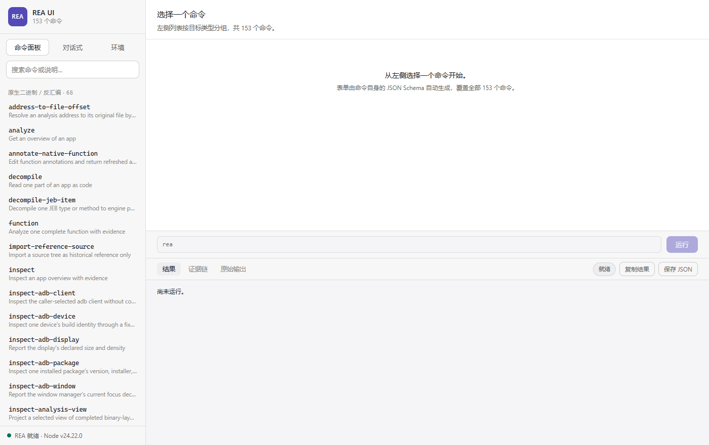
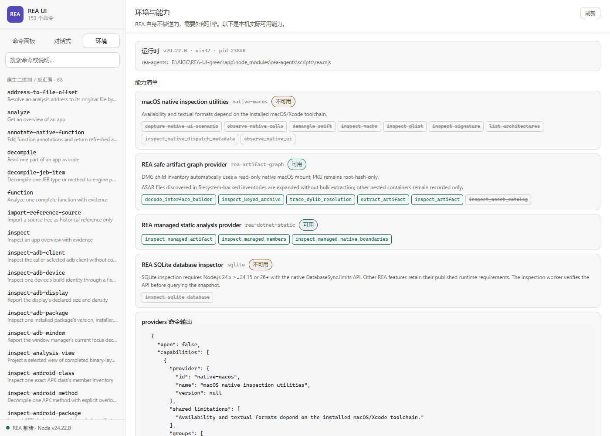

# REA UI

REA (Reverse Engineer Anything) 的图形界面封装。**解压即用,不需要装 Node。**

REA 是 [morluto/rea](https://github.com/morluto/rea) —— 一个 24 万星的开源项目,
让 AI Agent 逆向分析一切,从应用行为一路深入到原生二进制。
本项目给它做了一套 Web 界面,并打包成 Windows 免安装绿色版。

**153 个命令的表单全部自动生成**,不是手工维护的 —— 原理见下文「工作原理」。

---

## 界面

### 命令面板

左侧 153 个命令按目标类型分组,可搜索。



### 表单自动生成

选中 `analyze-javascript-application` 后自动渲染出参数、选项、默认值与说明,
底部实时显示将要执行的命令行:


### 真实运行

对 Electron 目标执行分析,17 个阶段进度流式返回,结果含 `evidence_id` 与 `sha256` 摘要:


### 环境与能力

逐个列出 provider 的可用状态和不可用原因 —— 缺引擎时直接告诉你怎么修,
而不是只丢一个退出码:



### 深色主题

界面跟随系统主题自动切换:


---

## 工作原理

REA 的 CLI 自带 introspection,这是本项目能覆盖全部命令的关键:

| 命令 | 作用 |
|---|---|
| `rea <命令> --schema --format json` | 该命令的完整 JSON Schema(参数、类型、枚举、范围、说明) |
| `rea --llms` | 全部命令清单与描述 |
| `rea capabilities --json` | provider 可用性、缺失原因、副作用 |

`tools/build-catalog.mjs` 直接驱动这些命令生成 `public/catalog.json`(153 条,约 95 秒),
界面再从 schema 渲染表单。**没有任何一个命令是硬编码的** —— REA 升级后运行
「刷新命令列表.bat」即可同步。

后端把每次执行作为独立子进程,进度通过 SSE 流式转发,长分析不卡界面。

---

## 安装

### 步骤

1. 下载 `REA-UI-green.zip` 并解压到任意目录(路径含中文或空格也可以)
2. 双击 **`启动 REA UI.bat`**
3. 浏览器自动打开 `http://127.0.0.1:7823`

端口被占用时脚本会自动顺延(7823→7853)。**关闭命令行窗口即停止服务。**

启动后会显示引擎状态:

```
  REA UI - Reverse Engineer Anything, graphical front-end
  ---------------------------------------------------
  URL: http://127.0.0.1:7823
  Engine: Ghidra D:\rea\ghidra  |  JDK D:\rea\jdk
  Close this window to stop the server.
```

### 绿色包已包含什么

| 内容 | 说明 |
|---|---|
| Node 24.22.0 | `runtime/node.exe`,无需系统预装 |
| rea-agents 6.5.0 | `app/node_modules/`,全部 153 个命令 |
| 界面 | `public/`,含自动生成的 catalog.json |
| 后端 | `server.mjs` |

**绿色包不含逆向引擎。** 见下节。

---

## 引擎:什么能用什么不能用

REA 本身不做逆向,它接入你已有的逆向工具。

| 目标类型 | 需要什么 | 现在能用吗 |
|---|---|---|
| JavaScript / Electron | 无 | ✅ 直接可用 |
| .NET 程序集 | 无 | ✅ 直接可用 |
| SQLite 数据库 | 无 | ✅ 直接可用 |
| Go / Rust 二进制 | 无(内置静态分析) | ✅ 直接可用 |
| 包与资源清单 | 无 | ✅ 直接可用 |
| **原生二进制(PE/ELF/Mach-O)** | Ghidra + JDK 21 | ⚠️ 见下 |
| Android APK | JADX + JDK | ❌ |
| 网站观察 | Chrome 系浏览器 | ❌ |
| Android 设备 | adb | ❌ |

### 原生分析需要装 Ghidra 12.1.x + JDK 21

1. 下载 Ghidra 12.1.4 并解压(免安装 zip 即可)
2. 安装 JDK 21(需含 `javac`,即完整 JDK,不是 JRE)
3. 把目标放成 **`ghidra_12.1.4_PUBLIC` 这样的目录名**

启动脚本会在这些位置自动查找:

```
%GHIDRA_HOME%
D:\rea\ghidra          C:\ghidra          C:\tools\ghidra
D:\ghidra              D:\tools\ghidra
%USERPROFILE%\ghidra   %ProgramFiles%\ghidra
```

放在别处就手动设一次:

```powershell
[Environment]::SetEnvironmentVariable('GHIDRA_INSTALL_DIR','C:\your\ghidra_12.1.4_PUBLIC','User')
```

### 关于 JAVA_HOME 的坑

脚本会**校验继承来的 `JAVA_HOME` 的主版本号**,不是 21 或 25 就自动换成探测到的 JDK。

这是必要的 —— 例如本机系统环境变量是 `JAVA_HOME=D:\java8`,而 REA 要求 JDK 21+,若直接沿用会导致所有原生分析失败。脚本的输出会明确告诉你最终用了哪个:

```
Engine: Ghidra D:\rea\ghidra  |  JDK D:\rea\jdk
```

### Hopper 和 IDA 在 Windows 上用不了

- Hopper:REA 明确返回 `unsupported_host`,不支持 Windows
- IDA:需要商业版和 Hex-Rays,还要配 `REA_IDA_MCP_CONFIG`

**Windows 上唯一可行的引擎是 Ghidra。**

### 验证安装

打开界面左侧的「**环境**」页,能看到每个 provider 的可用状态;或命令行执行:

```
runtime\node.exe app\node_modules\rea-agents\scripts\rea.mjs doctor --provider ghidra
```

`healthy: true` 就是就绪。

---

## 界面使用

界面共三个页签,顶部主界面截图已展示命令面板与环境页,下面补充对话式说明。

### 命令面板

左侧是**全部 153 个命令**,按目标类型分组,可搜索。

1. 选命令 → 表单**自动生成**(由命令自身的 JSON Schema 驱动,不是手写的)
2. 填参数,底部实时显示将要执行的命令行,可直接复制到命令行用
3. 点「运行」或按 `Ctrl+Enter`
4. 运行中显示进度流;结束后可切「结果 / 证据链 / 原始输出」三个视图

「结果」视图会把大数组折叠,「证据链」抽取出 evidence、provenance、sha256 等字段。

**缺引擎时会看到醒目提示**,列出每个引擎缺什么、怎么修,而不是只给一个退出码。

### 对话式

用自然语言描述目标,助手会挑选并运行 REA 命令。

点「模型设置」填入 OpenAI 兼容的 Base URL / API Key / 模型名。配置只存在本机浏览器 localStorage,不经过第三方。

> 这一栏需要你自己的 API Key 才能用,我无法替你验证。

### 环境

显示本机实际可用能力,逐个列出 provider 的 operations 及不可用原因。

---

## 批量反编译(可选)

反编译整个二进制的所有函数,**一次 Ghidra 会话完成**:

把目标文件**拖到 `批量反编译.bat` 上**,或运行后粘贴路径。

输出在 `<包目录>\analysis\<文件名>\<目标名>\`:

| 目录 | 内容 |
|---|---|
| `local/` | 本文件真正定义的函数 |
| `imported/` | 导入符号(通常业务逻辑在这里) |

每个函数两个文件:`.c` 是反编译伪代码,`.asm` 是反汇编指令。

最后重新生成索引:

```
runtime\node.exe tools\build-index.mjs --dir "<输出目录>\local"
runtime\node.exe tools\build-index.mjs --dir "<输出目录>\imported"
```

每个目录会得到 `README.md`(带链接的表格)和 `index.json`。

### 耗时参考

以 `libblkares.so.1`(4 MB,1038 个函数)为例:

| 阶段 | 耗时 |
|---|---|
| 本地层 54 个 | 约 1 分钟 |
| 导入层 984 个 | 约 11 分钟 |

**为什么不用界面逐个跑:** REA 每次只回答一个问题,每个问题都要重新导入目标,
8 个函数就要 20 分钟,1038 个得跑十几个小时。所以批量模式改成在 Ghidra 内部
遍历 `FunctionManager`,一个进程内全部反编译完。

---

## 目录结构

```
REA-UI-green/
├── 启动 REA UI.bat          一键启动
├── 批量反编译.bat           全量反编译
├── 刷新命令列表.bat         REA 升级后重抓命令与表单
├── server.mjs               本地后端
├── public/                  界面 + catalog.json
├── runtime/node.exe         内置 Node
├── app/node_modules/        rea-agents 及依赖
├── tools/
│   ├── build-catalog.mjs    抓取 153 个命令的 schema
│   ├── build-index.mjs      生成反编译索引
│   ├── decompile-to-files.mjs  单函数反编译并落盘
│   ├── decompile-all.mjs    单会话批量反编译
│   └── ghidra/              Ghidra headless 脚本(.java + .class)
└── README.md
```

---

## 常见问题

**启动报端口占用**
脚本会自动顺延。若仍失败,说明 7823-7853 都被占了,手动设 `REA_UI_PORT`。

**界面打不开**
确认命令行窗口还在(关掉即停服务),然后访问它打印的 URL。

**命令报 `provider_unavailable`**
引擎没装或没被识别。看启动窗口的 Engine 行,或看界面「环境」页的原因说明。

**原生分析报 java 相关错误**
`JAVA_HOME` 指向了旧 JDK。启动脚本会自动纠正,但如果你在 PowerShell 里手动跑,
需要自己设对。

**反编译结果里类型是 `undefined`**
PDB 没被加载。Ghidra 能读取**目标文件同目录下的 `.pdb`**,
加载后字段名会恢复(如 `this->mpVar` 取代 `*(int *)(this+4)`)。

**想清空重来**
删掉整个目录即可,除了 `app/node_modules` 里的 rea-agents 无法免安装分发外,
没有别处写数据(Ghidra 用的是临时工程,用完即删)。

---

## 博文

项目介绍文章见 [`blog/REA-UI-介绍.md`](blog/REA-UI-介绍.md)，
自包含的 HTML 版本（含 base64 内嵌截图，可离线浏览）见
[`blog/REA-UI-介绍.html`](blog/REA-UI-介绍.html)。

重新生成 HTML：

```bash
node tools/build-blog-html.mjs
```

---

## 支持

如果你觉得这个工具省了时间,欢迎赞助一杯咖啡 ☕

<table>
<tr>
<td align="center"><br><b>微信支付</b></td>
<td align="center"><br><b>公众号</b></td>
</tr>
<tr>
<td align="center">扫码赞助</td>
<td align="center">技术动态与更新</td>
</tr>
</table>

---

## 许可

本工具是 REA 的**第三方界面封装**。REA 由 morluto 维护,MIT 许可。

请仅在你拥有或已获授权分析的软件上使用。第三方组件各自保留其许可,
商业工具(IDA / Hopper / JEB)需自行获得合法授权。

本项目自身的源码以 MIT 许可发布(见 [LICENSE](LICENSE))。
第三方声明见 [NOTICE](NOTICE)。

