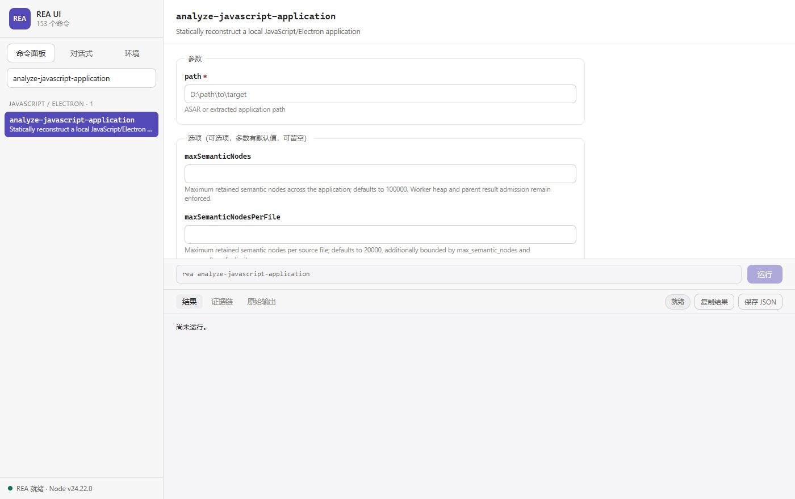
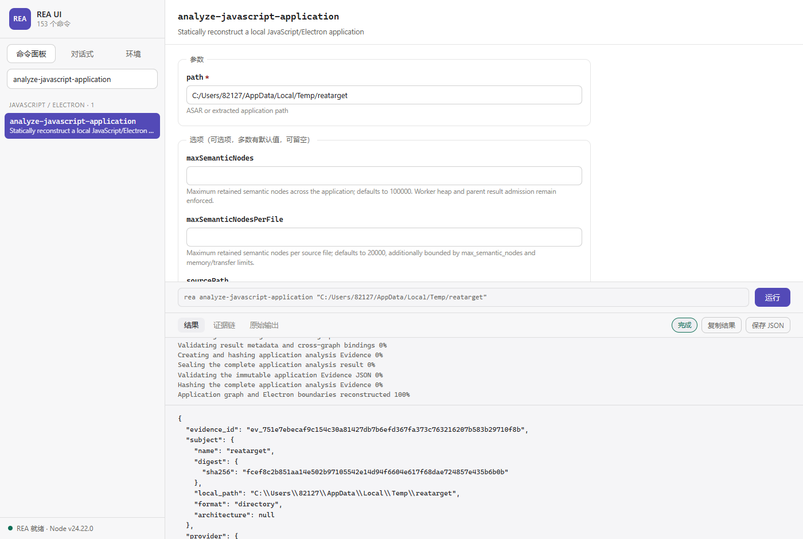
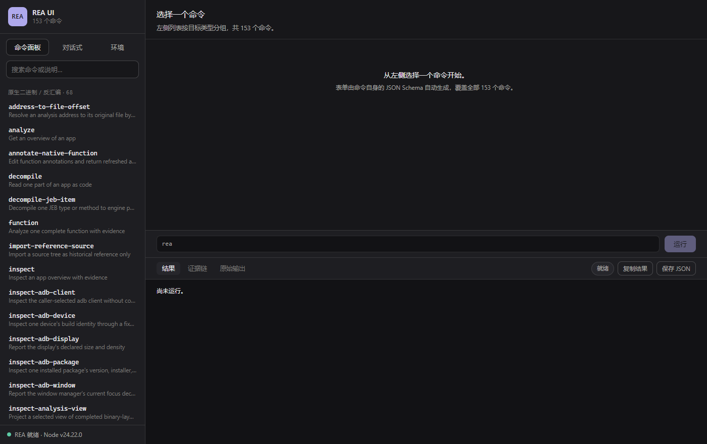

# 给 REA 套一层 GUI：153 个命令的界面是怎么自动长出来的

> 三个月前我做过一个「界面驱动」的逆向分析项目，最后卡在了一个很具体的地方：一个工具要人手动配置 153 个不同的参数面板，写到手软，而且一升级就全废。
>
> 最近 REA 更新到 6.5.0，我重做了一遍，这次只写了不到 2000 行就把这事解决了。

## 先说 REA 是什么

[REA (Reverse Engineer Anything)](https://github.com/morluto/rea) 是 `morluto` 做的开源项目，在 GitHub 上已经冲到 **26 万星**，是这两年增长最快的开发者工具之一。Replit CEO Ahmad Msad 评价它：「AI 驱动的逆向工程和反编译领域正在发生的事情简直不可思议。很快，所有软件都可能事实上变成开源软件。」

它解决的是这么一件事：

> 你在某个 App 里看到一个好用的功能，想知道它怎么实现的，然后在自己的产品里做一个类似的。问题是——你没有这个软件的源码。

REA 的做法是让 AI Agent 通过 MCP 协议去逆向。装好之后，你在 Claude Code 或 Codex 里直接说人话：

```
Understand how search works in the Notes app, show me the evidence,
and build a similar feature for my project.
```

它就自己去调 Ghidra、Hopper 这些逆向工具，把结果分析成伪代码给你，还能顺带把下载的 APK 拆开看清单、反编译 Java 方法、观察浏览器行为、比对两个版本的差异。

官方仓库里几个已验证的案例挺能说明它到底能干什么：

- **DX-Ball** — 逆向 DOS 游戏里声音随位置左右偏移的计算逻辑，重写的 C 函数通过了 3205 组测试，连编译出的 63 字节机器码都和原版一致
- **Notion** — 追踪 Electron 渲染进程的剪贴板 API 调用，穿过 preload 和 IPC 一直到主进程，途中还顺带分析了富文本剪贴板格式
- **TH04** — 分析 PC-98 版《东方幻想乡》的 16 位指令，还原出固定角度和自瞄角度两套计算，再把重写的 C++ 和当年编译器的输出做对比

**但有个问题**：REA 目前的形态只有两个——命令行 CLI 和 MCP Server。

对已经在用 Claude Code 的开发者没问题，但这东西的门槛比想象中高。你得先装 Node、配 MCP、理解一堆 provider 概念（Hopper/Ghidra/IDA 谁在谁不在、JDK 版本对不对），然后才能开始干活。

我想要的，是一个能双击就用的东西。

<!-- 截图：命令面板 -->


## 153 个命令，一个一个写？

我最初想的是：那就老老实实给每个命令做一个表单。

然后我去数了一下 CLI 有多少命令。

**153 个。**

里面还有 `analyze-javascript-application`、`inspect-managed-members`、`trace-native-ui-action` 这种名字长到要换行的。涉及的目标类型有原生二进制、JS/Electron、.NET、APK、网站、固件、pcap、SCTP 信号记录、SQLite、WASM、EVM 字节码、Flutter……每个类型的参数还不一样。

写 153 套表单？光想想就头皮发麻。而且 REA 更新频繁，今天新加两个命令、明天改一个参数，我这个界面就全废了。

**转念一想：这事儿不该我干，REA 自己知道。**

## 让 REA 自己描述自己

我去翻 REA 的 CLI，发现它自带 introspection（自省）能力：

| 命令 | 作用 |
|---|---|
| `rea <命令> --schema --format json` | 该命令的完整 JSON Schema，包含参数、类型、枚举值、取值范围、默认值、每一项的说明文字 |
| `rea --llms` | 全部命令清单和描述 |
| `rea capabilities --json` | 当前哪些 provider 可用、不可用的原因是什么 |

这意味着：**表单可以直接从命令的 Schema 生成。**

<!-- 截图：schema 驱动的表单 -->


我写了 `tools/build-catalog.mjs`，驱动 REA 自己的 CLI 把 153 个命令的 Schema 全部导出成一份 `catalog.json`（10 个并发进程，95 秒跑完）。前端再读这份 Schema 渲染表单：

- 参数名、类型（字符串/整数/布尔/数组/枚举）从 Schema 读
- 默认值、最小最大限制直接预填
- 描述文字作为提示显示在输入框下面
- 必填项标红，没填满就不让点运行
- 底部实时显示将要执行的命令行，可以直接复制到终端用

**结果是：代码里没有一个命令名是硬编码的。**

REA 以后加新命令、改参数，我跑一下 `刷新命令列表.bat` 就行，不用改一行前端代码。

## 界面长什么样

主体就是命令面板。左边 153 个命令按目标类型分组，带搜索；右边表单；下方是实时输出。

<!-- 截图：运行结果 -->


跑一个 Electron 应用的分析，17 个阶段的进度流式刷新，结果是 139 KB 的 JSON，带 `evidence_id`、各种 `sha256` 摘要、`confidence` 字段，还有 `limitations` —— REA 会明确告诉你哪些结论是推断的、哪些是观测到的、哪些地方它不确定。这个诚实度比很多商业工具强。

结果视图我做了折叠处理，不然一个真实应用的 Evidence 能到几百 MB，直接把浏览器撑爆。数组超过 12 项时只展开头尾各 6 项，中间标注总数和省略数；超过 400 字符的字符串会截断并标出原始长度。需要时切「原始输出」看完整内容。

「证据链」标签页会自动把 `evidence`、`provenance`、`sha256`、`confidence` 这类字段抽出来单独展示，不用在几万行 JSON 里翻。

深色主题是跟着系统走的：

<!-- 截图：深色主题 -->


## 缺引擎的时候，别只丢个退出码

这是我踩过的一个坑。

你第一次用原生分析功能，如果没装 Ghidra，REA 会返回一个非零退出码。绝大多数工具的做法就是打印一行错误，然后你就自己去猜吧。

REA 其实返回了很结构化的诊断信息——它明确告诉你每个引擎缺什么、怎么修。但命令行下这坨 JSON 没人愿意读。

所以我在界面上把它渲染成人话了：

<!-- 截图：环境与能力 -->


右边这个面板会逐个列出每个 provider 的可用状态：

- **ghidra** — `Set GHIDRA_INSTALL_DIR to an extracted Ghidra 12.1.x release directory`
- **hopper** — `Hopper integration is not supported on win32`（Windows 上根本用不了）
- **ida** — `Set REA_IDA_MCP_CONFIG to an upstream IDA MCP JSON registration`

点一下具体命令，如果失败原因是「引擎不可用」，界面顶部会弹一条横幅，写清楚缺哪个引擎、为什么、怎么修——而不是甩给你一个 `exit code 1`。

## 绿色包：62 MB，双击即用

不想装 Node、不想配环境变量、不想 `npm install`——所以打了个 Windows 免安装包。

```
REA-UI-green/
├── 启动 REA UI.bat        ← 双击这个
├── 批量反编译.bat
├── 刷新命令列表.bat
├── server.mjs             本地服务，包装 REA CLI
├── public/                界面 + catalog.json
├── runtime/node.exe       内置 Node 24.22.0
└── app/node_modules/      rea-agents 及其依赖
```

解压后双击 `启动 REA UI.bat`，浏览器自动打开 `http://127.0.0.1:7823`。关掉命令行窗口就停止服务。端口被占用会自动顺延，不会和已运行的实例打架。

**启动脚本会自己找 Ghidra。** 这地方有个坑值得说：我这台机器的系统环境变量 `JAVA_HOME` 指向 Java 8，而 REA 要求 JDK 21+，直接沿用会让所有原生分析失败。所以脚本会**校验主版本号**，不是 21 或 25 就自动换成探测到的 JDK，并且在启动时明确告诉你最终用了哪个：

```
Engine: Ghidra D:\rea\ghidra  |  JDK D:\rea\jdk
```

如果没装引擎，它也会直说，而不是默默降级：

```
No Ghidra engine. Static analysis works; native binaries need Ghidra 12.1.x + JDK 21.
```

打包时我把体积从 345 MB 压到 62 MB（zip），主要是发现 `frida` 带了 **130 MB 的 C 源码构建中间产物**，而它只是 `rea-agents` 的 optionalDependency，运行时根本不加载。

## 批量反编译：把 1038 个函数压进 11 分钟

这个功能是后来加的。

我原本想用界面对着一个二进制逐个点反编译。点了 8 个之后我放弃了——**这 8 个花了 20 分钟**。

原因在 REA 的架构：它每次只回答一个问题，而**每个问题都要把目标重新导入一次 Ghidra**。按这个速度，1038 个函数要跑十几个小时。

但 Ghidra 本身有批量能力。绕过 REA 直接调 Ghidra headless，写了个脚本在**一次会话内**遍历 `FunctionManager`，把每个函数依次过一遍反编译器：

```java
DecompInterface decomp = new DecompInterface();
decomp.openProgram(currentProgram);
for (Function f : fm.getFunctions(true)) {
    DecompileResults r = decomp.decompileFunction(f, 120, monitor);
    // 写出 .c 和 .asm
}
```

把目标文件拖到 `批量反编译.bat` 上就行。结果：

| 阶段 | 函数数 | 耗时 |
|---|---|---|
| 本地定义 | 54 | 约 1 分钟 |
| 导入符号 | 984 | 约 11 分钟 |

**1038 个函数，零失败。** 相比逐个调用快了三个数量级。

顺手还发现个好东西：Ghidra 能自动读取**目标同目录下的 `.pdb`**。加载成功后，伪代码里的字段名会从裸偏移变成真实名字：

```c
// 没有 PDB
return **(short **)this;

// 加载 PDB 后
return *(short *)this->mpVar;
```

`mpVar` 是从 PDB 恢复出来的。所以我特意警告：**没有 PDB 的二进制，反编译结果里的字段名全是猜的。**

## 一点点技术选型的取舍

**为什么用 SSE 而不是 WebSocket？** 只需要服务端单向推进度，SSE 更轻，Node 原生支持，不用额外依赖。

**为什么自己抓 stdout 而不是让 REA 输出到文件？** 进度信息是 `{"rea_progress":{...}}` 这样的行分隔 JSON，边跑边解析才能实时显示。这里踩过一个坑：REA 写 stdout 不保证一次写一行，得自己缓冲到换行符，否则 JSON 会被截断成好几段（我第一次就踩了，表现为结果里出现 6 个截断的片段而不是 1 个完整对象）。

**为什么命令面板还要保留命令行预览？** 因为懂命令行的人可以直接复制走，在终端里跑。UI 不该绑架用户。

## 一些局限

说完好的，也说说不足：

- **对话式面板需要你自己的 API Key。** 这个我没法替你验证，我测试环境里没有可用密钥。配置只存本机浏览器 localStorage，不经过第三方。
- **PDB 的作用被低估了。** 上面说了，有 PDB 和没 PDB 的反编译质量是两个档次。如果你在分析自己编译的程序，一定记得把 PDB 放旁边。
- **Hopper 在 Windows 上用不了。** REA 明确返回 `unsupported_host`。Windows 上唯一的原生分析引擎是 Ghidra。IDA 能用，但要商业版。
- **只覆盖了 REA 的能力边界。** REA 本身不做逆向，它接入你已有的工具。没装引擎的机器上，JS/Electron、.NET、SQLite、Go/Rust 二进制这些静态分析照常可用，原生二进制就得先装引擎。

## 下载

**绿色安装包（62 MB，解压即用）**

百度网盘：<https://pan.baidu.com/s/1YFZCNFWtR7iwk4Vs_mkZkQ?pwd=dyef>
提取码：`dyef`

**源码**

GitHub：<https://github.com/wyfirstname/rea-ui>

MIT 许可。源码里包含全部构建脚本，你可以自己改界面、打包，或者照着改出一个自己顺手的版本。

---

REA 本身是 MIT 许可，`morluto` 维护。请仅在你拥有或已获授权分析的软件上使用它——逆向这事儿，技术上能做到和有权做到是两回事。
